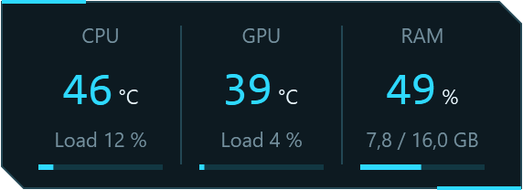
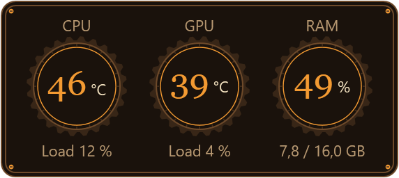
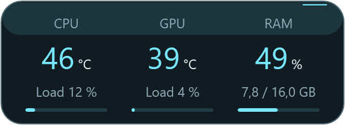
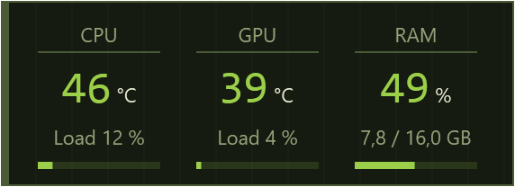
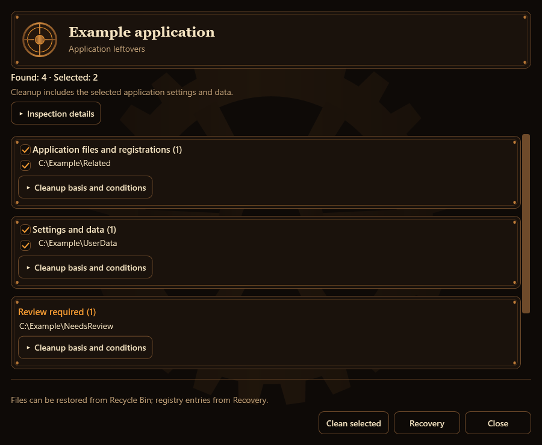
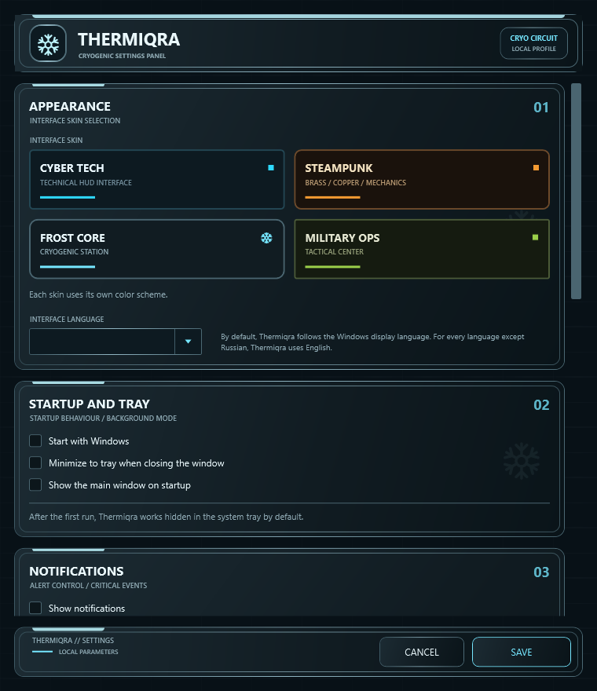

# Thermiqra

**Know your hardware. Follow its history. Understand what takes up space.**

Thermiqra is a free Windows desktop application that brings hardware monitoring, diagnostics, local history, disk analysis and application removal into one place. It explains the readings it can obtain and says when the available evidence is insufficient.

[Download the latest release](https://github.com/grishachev/Thermiqra/releases/latest) · [What's changing](CHANGELOG.md) · [Report a problem](https://github.com/grishachev/Thermiqra/issues)


> **Current stable release: [Thermiqra 1.1.1](https://github.com/grishachev/Thermiqra/releases/tag/v1.1.1).** Download the installer from the release page; the signature and checksum files are used for verification.

## What's fixed in 1.1.1

- The additional AppData association search completes its configured scope instead of stopping after two seconds or fixed folder counts.
- A fresh history inspection removes the obsolete association-search timeout warning; genuine read failures remain visible.
- Update highlights are localized for older 1.0.0 clients as well as newer versions.
- Cleanup ownership checks, shared-data safeguards and protected paths remain enforced.

See the [1.1.1 release notes](docs/releases/1.1.1.md) and [change log](CHANGELOG.md) for details.

## Features introduced in the 1.1 series

| Area | What changes |
| --- | --- |
| **Application removal — New** | Installed Windows and Microsoft Store applications, native uninstallers, installation history, leftover inspection, recovery and automatic verification after cleanup |
| **Tray monitoring panel — New** | Compact CPU/GPU/RAM readings, hover by default, optional persistent display, four distinct skins, and cooperation with neighboring tray menus and tooltips |
| **CPU detail** | Logical-processor load view, clearer core/thread information and improved clock presentation |
| **Disk analysis** | Large total, used and free capacity figures at the top, including a clear state when values are unavailable |
| **Hardware compatibility** | Additional graphics and storage information sources, careful fallback handling and clearer boundaries between known and unavailable health data |
| **Update protection — New** | Installer verification with a built-in public key, required SHA-256 and another check before launch; no paid Windows signing certificate required |
| **Interface quality** | English/Russian translation fixes, compact cleanup results, visible progress and consistent themed operation screens |
| **Regression coverage — New** | Automated checks, a Windows CI workflow and an EXE/MSI regression suite exercised in disposable Windows |

Read the [detailed change log](CHANGELOG.md) for behavior, fixes and limitations.

## At a glance

| Feature | What you can do |
| --- | --- |
| **Live monitoring** | Follow CPU/GPU temperature and load, RAM usage, drive space and available storage temperatures |
| **CPU detail** | Inspect individual logical-processor load and available clock information |
| **System information** | Inspect processor, graphics, motherboard, memory, storage and Windows details |
| **Memory diagnostics** | Read available module/slot information, SPD, JEDEC and XMP 2.0 profiles |
| **Storage health** | Inspect available ATA SMART and NVMe health evidence, warnings and technical details |
| **Statistics** | Explore local SQLite history for Today, 24 hours, 7 days and 30 days, with charts, averages, maxima and timestamps |
| **Hardware changes** | Review detected changes in the observed hardware configuration |
| **Reports** | Export diagnostic TXT, statistics CSV and visual HTML summaries |
| **Disk analysis** | Browse drive → folder → file usage, examine large branches and preview cleanup |
| **Application management — New** | Run native uninstallers and inspect supported leftovers without repeatedly switching Thermiqra windows |
| **Guidance** | Read explanations and conservative upgrade suggestions based on available hardware and repeated usage |
| **Alerts** | Configure thresholds, themed notifications, sounds and warning/critical event history |
| **Appearance** | Choose Cyber Tech, SteamPunk, Frost Core or Military Ops, in English or Russian |

## Screenshots and interface previews

All examples below use the English interface. These are existing renders of Thermiqra's actual UI components with illustrative readings and example application paths, prepared during interface and localization checks. They demonstrate layout and appearance, rather than hardware results from a particular computer.

### Compact monitoring in all four skins — New

| Cyber Tech | SteamPunk |
| --- | --- |
|  |  |
| **Frost Core** | **Military Ops** |
|  |  |

### Leftover review — New

Confirmed application files, settings/data, items requiring review and protected objects appear in compact groups. You can expand the reasons when needed.



<details>
<summary>English settings example</summary>



</details>

## Hardware readings you can interpret

Thermiqra uses available hardware sensors and Windows information sources. What a particular PC exposes depends on its devices, firmware, drivers, controller and connection type.

- CPU and GPU temperatures, utilization and available clocks.
- GPU Hot Spot and VRAM temperatures where exposed.
- RAM usage and available module/slot details.
- Physical storage temperatures and logical-volume capacity.
- ATA SMART attributes and supported NVMe health information.
- A logical-processor load view accessible from the CPU monitor.

**Unavailable is not the same as healthy.** Thermiqra does not invent a universal health percentage or label a disk healthy merely because no temperature or failure flag was returned. Unsupported or incomplete readings remain explicitly unavailable or insufficient. A health report is diagnostic evidence, not a guarantee against future hardware failure.

Memory profile information has the same boundary: an XMP profile stored in SPD does not by itself prove that the profile is currently active.

## Local history, explanations and reports

Monitoring history is stored locally in SQLite. Charts show available CPU, GPU, RAM and per-device storage measurements, together with averages, maxima and timestamps. You can compare periods, inspect recurring warning/critical events and review hardware records.

Smart Guidance explains important readings alongside the underlying values. Upgrade Advisor looks for repeated usage evidence; a single spike does not justify an upgrade recommendation, and recognized benchmark activity is excluded from its evidence. Thermiqra does not invent FPS gains or an overall PC score.

Export a technical TXT report when troubleshooting, CSV statistics for further analysis or an HTML summary with charts. The first-run introduction can be reopened from Settings.

## Disk analysis and cleanup

The Storage Analyzer shows an expandable hierarchy with file/folder counts, logical and allocated sizes, usage shares and the largest branches. **Version 1.1.0 places total, used and free capacity directly in the top drive block**, so the headline figures are visible immediately.

NTFS volumes can use a fast MFT-based path. Other supported file systems use directory traversal. Connected removable volumes can appear without restarting Thermiqra.

Safe Cleanup previews known cleanup candidates before making changes. Unknown folders do not become disposable just because their names resemble temporary data. Where a cache rule only permits deleting contents, the containing folder is preserved. Downloads and Recycle Bin have dedicated actions; ordinary file deletion remains an explicit user action, with available Recycle Bin/permanent-delete choices.

## Application removal and recovery — New

### One workflow, visible progress

Thermiqra lists Windows applications from supported machine/user registrations and handles Microsoft Store/MSIX applications separately. Program icons are resolved from available registration, executable and shortcut information. A portable executable without an installation registration is not necessarily an installed application and may not appear in this list.

The removal workflow keeps Thermiqra's own stages in one window: confirmation, restore-point handling, native removal, leftover review, cleanup and verification. A vendor's own uninstaller may still display its own window.

Thermiqra records observed installations and changes while it runs and saves information before removal. This improves later inspection; it is **not** a complete installation-activity recorder and cannot reconstruct every change made before Thermiqra observed the application.

### Cleanup based on evidence

- Inspect known installation paths, supported product settings/data locations, registry entries and related shortcuts.
- Use saved observations and product identity alongside the current installed-program inventory.
- Select eligible, confirmed leftovers by default; show ambiguous and protected objects separately.
- Revalidate objects immediately before cleanup, including changes since inspection, shared ownership and links.
- Protect system locations, shared/vendor roots and Windows-managed package directories.
- Keep canceled, failed, incomplete or restart-pending removal distinct from confirmed completion.
- Save attempts and results so an application disappearing from the installed list does not erase the removal history.

Selected application data folders include the settings, accounts, projects or saves stored inside them. Review that selection if you want to keep such data. Parent vendor folders and unrelated products are not cleanup targets merely because they share a name.

### Recovery and final verification

Eligible files go to the Windows Recycle Bin. Registry changes use Thermiqra's typed backup format and can be restored from **Recovery**; this is not a plain `.reg` export. Windows restore-point creation and its failures are handled explicitly where requested or required. Windows quotas and restore-point frequency limits are not bypassed.

Cleanup is followed by a fresh inspection automatically. The result distinguishes no leftovers in the checked locations, remaining objects and inspection limitations. A long per-file journal stays behind an expandable control.

**This is not a promise to remove every trace of every application.** Arbitrary services, drivers, scheduled tasks, firewall rules, shell extensions and externally stored user files are not covered by a universal cleanup engine. Windows manages Store package files and may retain them for other users or servicing; Thermiqra does not forcibly delete `WindowsApps`.

## Tray monitoring that stays out of the way — New

Hover over the Thermiqra tray icon for a compact CPU/GPU/RAM panel. **Hover is the default**; Settings can keep the panel visible instead. Each skin has its own layout and visual treatment.

In persistent mode, simply moving across the taskbar or neighboring icons does not dismiss the panel. Other tray tooltips can appear above it. Opening a neighboring tray menu temporarily hides it, and it can return after the menu closes. The panel does not take keyboard focus.

The panel reuses existing monitoring readings instead of starting a second hardware collector. GPU temperature and utilization belong to the same selected GPU. Missing values stay unavailable.

## Updates and verification

Thermiqra checks GitHub Releases, shows a compact summary and can download/install an update while preserving settings and statistics. You can cancel a download or open the full release notes.

**Starting with the 1.1.0 updater**, an installer must match its SHA-256 and a signature verified with Thermiqra's embedded public key. The signed metadata binds the exact version, file name, size and hash. Verification is repeated before launch. Missing or invalid required verification data stops that update.

This uses the project's own offline signing key, **not paid Authenticode certification**. It does not remove Windows SmartScreen warnings or change the UAC publisher name.

**Transition:** existing 1.0.0 installations obtain this update using their existing updater. They cannot retroactively gain the new signature check before installing it. The new verification protects subsequent updates. First-time downloads and protection of the release account/private key remain separate considerations.

Release assets for the new updater include the installer, its `.exe.signature.json` file and a `.exe.sha256` checksum. See [release-signing documentation](Tools/ReleaseSigning/README.md) for the maintainer workflow. Private keys are not distributed with the source, installer or CI.

Very old 0.6.0–0.6.2 installations should install a newer release manually once because of limitations in those historical update flows.

## Reliability work

The current local validation baseline includes **274 passing automated checks**, plus a separate disposable-Windows EXE/MSI run with **16 scenarios and 424 successful assertions**. The latter was run on November 16, 2026; it is not a claim that every later change received a new full guest run.

Coverage includes storage-health interpretation, protected paths, shared components, product separation, observed changes, registry recovery/collisions, failed/canceled removal, active child processes, restart handling, update integrity/signatures, English/Russian text and four-skin UI states. A native-window test also covers tray panel/tooltip stacking.

The real Windows suite exercises purpose-built EXE and MSI applications, not hundreds of arbitrary commercial programs. Full Windows rollback through System Restore is separate from recovery of Thermiqra's registry backups and test files. A Windows GitHub Actions workflow is included; local results are not presented as proof that a remote Actions run has succeeded.

See [validation notes](RELIABILITY_CHECKS.md), [the removal matrix and saved report](Tools/RemovalLab/Matrix/README.md), [automated tests](Thermiqra.Tests) and [localization checks](Tools/LocalizationAudit/README.md). Development notes may remain in Russian; the public overview and release description are English.

## Requirements and installation

- **Windows 10 or Windows 11, x64.** Windows 7/8 are not supported.
- Administrator rights: the application requests elevation for hardware access and privileged operations.
- Hardware/driver support for the measurements you want to inspect.
- PawnIO for supported low-level hardware access.

Download the installer from [GitHub Releases](https://github.com/grishachev/Thermiqra/releases/latest). Thermiqra runs locally without an account or mandatory cloud service. Update checks/downloads use GitHub.

Settings, statistics and application-management records are stored under `%LocalAppData%\Thermiqra`. Thermiqra's uninstaller can keep or remove its settings/history. PawnIO is not automatically removed with Thermiqra because other software may use it.

## Build and checks

The internal project/namespace remains `PCHardwareMonitor`; the public application name is Thermiqra. The application uses C#, WPF, .NET 10, LibreHardwareMonitor, Microsoft.Data.Sqlite, Windows management interfaces and Inno Setup.

```powershell
dotnet build PCHardwareMonitor/PCHardwareMonitor.csproj -c Debug
dotnet test Thermiqra.Tests/Thermiqra.Tests.csproj -c Debug
dotnet run --project Tools/LocalizationAudit/LocalizationAudit.csproj
```

For a self-contained x64 publish:

```powershell
dotnet publish PCHardwareMonitor/PCHardwareMonitor.csproj -c Release -r win-x64 --self-contained true -o PCHardwareMonitor/bin/Release/net10.0-windows/win-x64/publish
```

The installer script is [Installer/Thermiqra.iss](Installer/Thermiqra.iss). Its PawnIO dependency is intentionally not committed; a local installer build requires `Installer/Dependencies/PawnIO_setup.exe`. Running the disposable Windows removal matrix is a separate, explicit procedure described in its documentation.

## Feedback and license

When reporting a problem, include the Thermiqra version, Windows version, affected device/application and the relevant diagnostic report or screenshot. Review reports before sharing them: hardware identifiers, user paths and installed-program details may be personal.

Thermiqra is **free to use**, but its original source and assets are proprietary. A public repository does not grant an open-source license. See [LICENSE](LICENSE) and [third-party notices](THIRD_PARTY_NOTICES.md) for the applicable terms.
