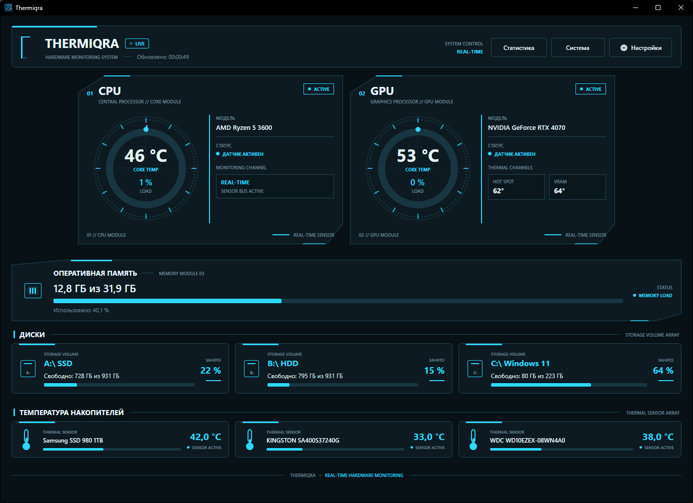
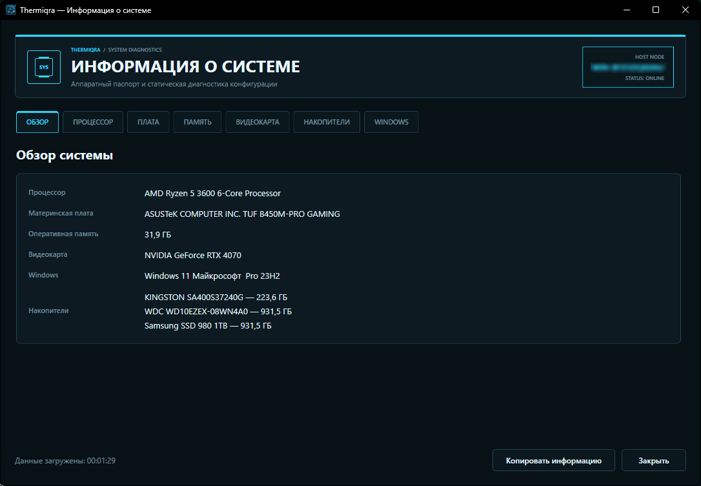
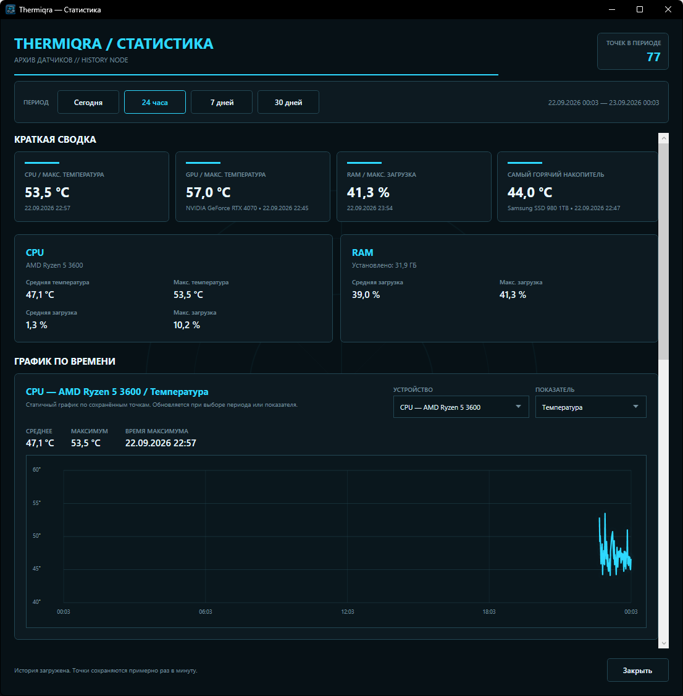
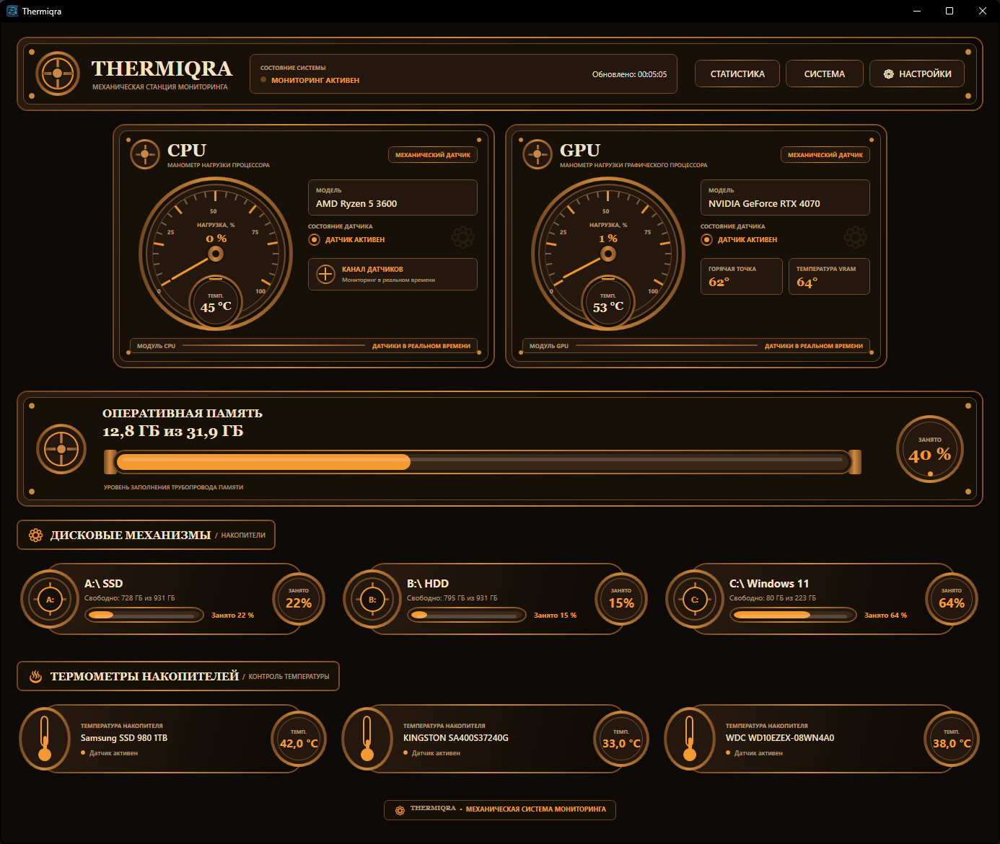

# Thermiqra

<p align="center">
  <strong>Real-time PC hardware monitoring, diagnostics, guidance, statistics and storage analysis for Windows 10/11.</strong>
</p>

<p align="center">
  <a href="https://github.com/grishachev/Thermiqra/releases/latest">
    
  </a>
  
  
  
</p>

<p align="center">
  
</p>

<p align="center">
  <a href="https://github.com/grishachev/Thermiqra/releases/latest"><strong>Download the latest Thermiqra release</strong></a>
</p>

Thermiqra is a native Windows desktop application for monitoring PC hardware in real time. It combines live CPU/GPU/RAM/storage data, detailed system information, memory diagnostics, local statistics, alerts, storage analysis, practical explanations, upgrade guidance, reporting and built-in updates in one application.

## Highlights

| Area | What Thermiqra provides |
| --- | --- |
| **Live monitoring** | CPU, GPU, RAM, physical storage and logical drive monitoring with one-second updates |
| **CPU threads** | Live load view for individual logical processors directly from the CPU monitor |
| **System information** | Detailed hardware and Windows information in a dedicated system view |
| **Memory diagnostics** | RAM module information, SPD data, JEDEC information, XMP 2.0 profiles, timings and upgrade information |
| **Smart Guidance** | Plain-language explanations of important hardware states without hiding the underlying technical values |
| **Upgrade Advisor** | Conservative upgrade suggestions based on installed hardware and repeated real usage, with benchmark periods excluded from recommendations |
| **Storage analyzer** | Fast NTFS/MFT analysis, full folder hierarchy, contextual explanations, safe cleanup, Downloads/Recycle Bin actions and user-confirmed deletion |
| **Statistics** | Local SQLite history for Today, 24 hours, 7 days and 30 days, with charts, averages, maxima and timestamps |
| **Reports and export** | Technical diagnostic TXT report, raw statistics CSV export and visual HTML summary report with charts |
| **History analytics** | Period comparison, recent summaries and recurring warning analysis based on local monitoring history |
| **Hardware changes** | One-shot detection of meaningful hardware configuration changes |
| **Alerts** | Custom themed Warning/Critical/Info notifications, selectable sounds, configurable thresholds and Warning/Critical event history |
| **Themes** | Cyber Tech, SteamPunk, Frost Core and Military Ops |
| **Localization** | Full English and Russian interface with automatic System language mode |
| **Background operation** | System tray support, temperature tooltip and elevated autostart through Windows Task Scheduler |
| **Removable drives** | Connected removable USB volumes appear dynamically without restarting Thermiqra |
| **Updates** | In-app GitHub Release checks, release notes, progress display, SHA-256 verification, cancelable downloads and automatic installation |

## Screenshots

The screenshots are currently shown with the Russian interface. Thermiqra also includes a complete English localization.

### System information and statistics

<p align="center">
  
  
</p>

### Themes

Thermiqra includes four complete interface skins. The screenshot below shows the SteamPunk skin.

<p align="center">
  
</p>

## Current release — 0.9.0

Thermiqra 0.9.0 focuses on making hardware information easier to understand and the storage analyzer much more useful without turning the application into an intrusive assistant.

### What's new

- new first-run introduction explaining the main Thermiqra areas and concepts
- Smart Guidance with short, plain-language explanations alongside technical data
- **What can be improved** Upgrade Advisor with conservative recommendations based on available hardware data and monitoring history
- benchmark detection so benchmark sessions do not distort Upgrade Advisor recommendations
- clearer CPU/GPU naming and additional interface polish
- redesigned Storage Analyzer with an expandable **drive → folders → subfolders → files** hierarchy
- folders are shown before files, with size sorting inside each group
- automatic focus on the heaviest storage branch without flooding the view with every nested file
- contextual explanations and safety notes for selected storage items
- **Safe Cleanup** preview with checkboxes before anything is removed
- verified cleanup rules for known temporary data and NVIDIA shader cache locations; folder containers are preserved where required
- dedicated **Downloads** and **Recycle Bin** cards with view and cleanup actions
- user-confirmed deletion of selected files and folders, with Recycle Bin and permanent-delete choices
- automatic storage re-analysis after cleanup or deletion
- manual **Check for updates** command in the system tray
- update prompts now show release notes from the GitHub Release description
- additional notification, Settings, Statistics and System Information UI refinements

Thermiqra intentionally keeps Safe Cleanup conservative: unknown folders are not treated as safe to remove merely because their names look like cache or temporary data.

See the [Thermiqra releases](https://github.com/grishachev/Thermiqra/releases) page for version-specific notes and downloads.

## First-run introduction and guidance

Thermiqra 0.9.0 includes a short introduction for new users. It explains the main monitoring areas, where to find additional information and how Thermiqra works in the background.

The introduction can be skipped and opened again later from Settings.

Smart Guidance is designed to explain what a value means and when it may deserve attention without replacing the actual hardware readings or inventing a synthetic PC health score.

## Upgrade Advisor

The **What can be improved** section uses information Thermiqra can actually observe.

Recommendations are intentionally conservative:

- a single short spike is not enough for an upgrade recommendation
- repeated real-world evidence matters more than one isolated reading
- recognized benchmark activity is excluded from Advisor evidence
- Thermiqra does not invent FPS gains or arbitrary overall PC scores
- when the available data is not sufficient, Thermiqra does not pretend to know the answer

## Memory diagnostics

Thermiqra's System Information view includes detailed RAM diagnostics where supported by the hardware and driver stack:

- installed memory modules and slot information
- SPD information
- JEDEC information
- XMP 2.0 profile detection
- SPD/XMP timing information
- occupied and available slot information for upgrades

> Thermiqra reports XMP profiles stored in SPD data. It does not claim that a specific XMP profile is currently active unless that state can be determined reliably.

## Statistics and history

Monitoring history is stored locally in SQLite. Thermiqra provides:

- Today / 24h / 7d / 30d periods
- CPU temperature and load history
- GPU temperature, load, Hot Spot and VRAM temperature when available
- RAM usage history
- per-device storage temperature history
- interactive historical charts
- average and maximum values with timestamps
- all-time hardware records
- Warning/Critical event history
- manual statistics clearing
- period comparison and history analytics
- CSV export and HTML summary reporting

## Storage analysis

Thermiqra includes a dedicated storage analyzer for understanding where disk space is going and acting on it without leaving the application for every step.

For NTFS volumes, Thermiqra can use a fast MFT-based analysis path. For exFAT, FAT32 and other supported file systems, it falls back to safe directory traversal.

The analyzer provides:

- expandable drive, folder, subfolder and file hierarchy
- logical and allocated file sizes
- file and directory counts
- size/share information
- largest branches and files
- contextual explanations for selected folders and files
- automatic navigation to important storage items
- conservative Safe Cleanup for known cleanup scenarios
- Downloads and Recycle Bin shortcuts
- user-confirmed file and folder deletion
- automatic refresh after cleanup or deletion

**Safe Cleanup never silently treats an unknown folder as disposable.** Before cleanup, Thermiqra shows what will be cleaned and lets the user deselect individual items.

For known cache locations where only contents should be removed, Thermiqra preserves the parent folder.

Ordinary files and folders are deleted only after an explicit user action. When applicable, Thermiqra offers a choice between moving the item to the Recycle Bin and permanent deletion.

Removable USB volumes are detected dynamically and can be analyzed without restarting Thermiqra.

## Automatic updates

Thermiqra checks GitHub Releases for newer versions and can install them automatically.

When an update is available, Thermiqra can show the release notes, download the matching installer, display download progress, verify the SHA-256 digest when GitHub provides one, start the installer in silent mode and launch Thermiqra again after installation.

Updates can also be checked manually from the system tray.

Starting with 0.8.1, the update download can be canceled safely. Closing the progress window or pressing **Cancel / Отмена** cancels the active download, and the main application remains usable.

Thermiqra 0.6.1 and 0.6.2 contain an older updater bug that can prevent automatic installation after the installer download completes. Users on those versions should install 0.6.3 or newer manually once. After that, future releases can use the corrected in-app update flow.

Users running Thermiqra 0.6.0 or earlier also need to install a newer release manually before using the in-app update flow.

## Localization

Thermiqra supports:

- **System** — Russian Windows uses Russian; other Windows UI languages use English
- **English**
- **Русский**

The main monitor, Settings, Statistics, System Information, Storage Analyzer, cleanup/delete dialogs, first-run introduction, tray menu, notifications and update interface are localized.

## Technology

- C# / WPF
- .NET 10
- LibreHardwareMonitorLib 0.9.6
- Microsoft.Data.Sqlite
- System.Management
- PawnIO
- Inno Setup

## System requirements

- Windows 10 or Windows 11
- x64 system
- administrator rights for installation and full hardware access
- PawnIO for supported low-level hardware access

## Build

Main project:

`PCHardwareMonitor/PCHardwareMonitor.csproj`

The Release build uses `win-x64` and self-contained publishing:

```powershell
dotnet publish .\PCHardwareMonitor\PCHardwareMonitor.csproj -c Release -r win-x64 --self-contained true -o .\PCHardwareMonitor\bin\Release\net10.0-windows\win-x64\publish
```

## Installer

Inno Setup script:

`Installer/Thermiqra.iss`

`PawnIO_setup.exe` is intentionally not stored in the repository. For a local installer build, place it at:

`Installer/Dependencies/PawnIO_setup.exe`

PawnIO is installed by the Thermiqra installer but is not automatically removed with Thermiqra because it may be used by other software.

## User data

Thermiqra stores user settings and local statistics in:

`%LocalAppData%\Thermiqra`

During uninstall, the user can choose whether to keep or remove Thermiqra settings and history.

## Project note

The public application name is **Thermiqra**. The internal project name and namespace currently remain `PCHardwareMonitor`.
